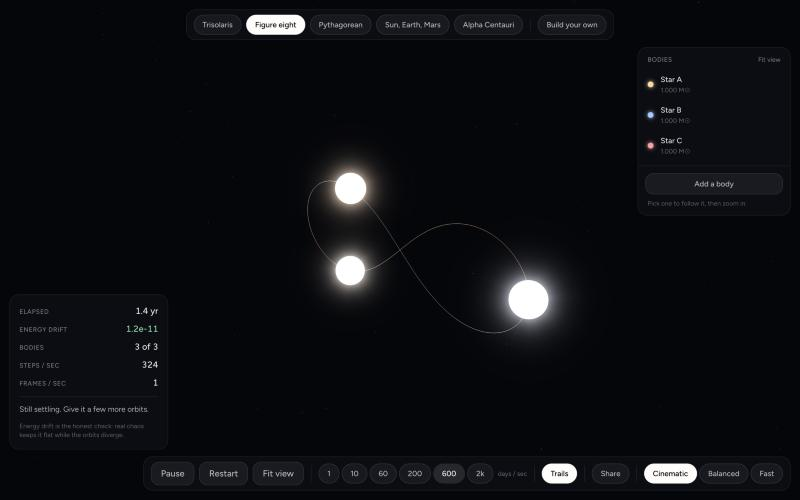
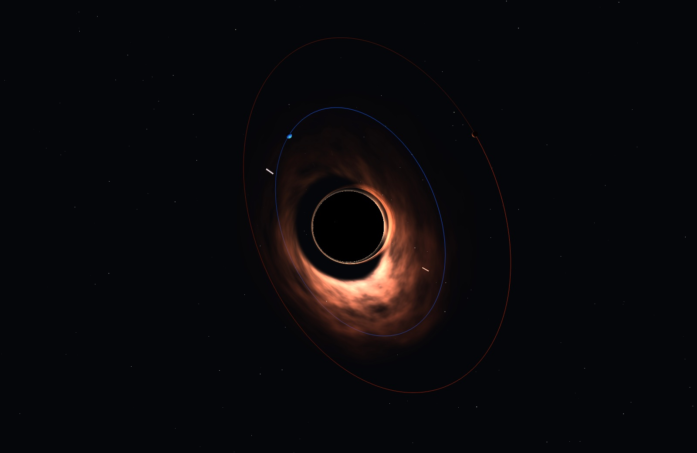
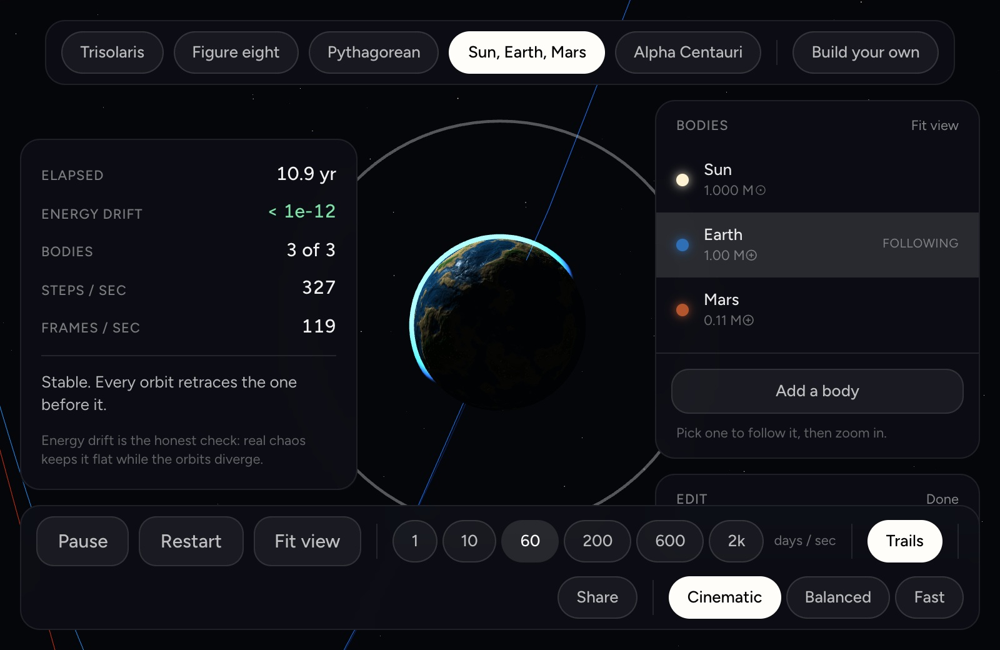

# Three Body

A gravity simulator you can share. Place stars and planets, pick real ones or invent your own, and watch whether the orbits hold.

**[three-body-theta.vercel.app](https://three-body-theta.vercel.app)**



*The Chenciner-Montgomery figure eight: three equal masses chasing each other around one shared closed path.*

## Why

The three-body problem has no general closed-form solution. Two bodies orbit predictably forever; add a third of comparable mass and the system becomes chaotic, which means its future depends so sensitively on where it started that no formula can shortcut it. The only way to find out what happens is to integrate the equations of motion and watch.

So that is what this does. The difference between an orbit that holds for a billion years and one that throws a planet into the dark is something you can see here rather than read about.

## What it does

- **Five systems to start from**, including the Trisolaris setup of three suns and one inhabited world, the figure-eight solution, and the Pythagorean problem that Meissel expected to be periodic in 1893 and which is not.
- **Build your own.** Start from an empty system, add real objects from a catalogue of stars, planets, exoplanets and compact objects, or invent one by setting its mass, radius, density and type. Choose each orbit's distance, eccentricity, inclination and direction.
- **Edit anything in place.** Change Earth's mass mid-flight and the simulation keeps running from where it is rather than rewinding.
- **It tells you what happened.** Stable, chaotic, ejected, collided, with the reasoning behind it.
- **Share a link.** Every system encodes into its URL, so you can send someone the exact thing you built.

## The physics

Lengths in AU, masses in solar masses, time in days, which makes the gravitational constant the square of the Gaussian gravitational constant. A circular orbit at 1 AU around 1 solar mass then has speed exactly `k` and a period of 365.2569 days.

Integration is symplectic: velocity Verlet, or Yoshida's fourth-order method by default. Symplectic matters more than raw per-step accuracy, because a non-symplectic method like RK4 lets energy drift in one direction, so long runs visibly decay or inflate. That failure looks like physics while actually being arithmetic.

The engine is isolated from the renderer and tested headless. Some of what the tests pin down:

| Check | Result |
|---|---|
| Figure-eight period, derived rather than assumed | 367.7408 days against the published value, 0.0000% error |
| Yoshida vs Verlet, coarse step on an eccentric orbit | 123,000x less energy drift |
| Centre of mass over 200,000 steps | holds to 1e-17 AU |
| Kepler's third law across 0.387 to 30.07 AU | constant to 1e-12 |
| Pythagorean problem | resolves to a bound binary plus an escaper, as Szebehely and Peters found in 1967 |

An adaptive timestep is not optional. The Pythagorean problem has a closest approach of about 4e-4 AU, where a fixed step produces relative energy errors between 10 and 10,000. Adaptive stepping costs the strict symplectic property and is still the only workable choice.

**What this does not claim.** In a genuinely chaotic system the fine detail is not reproducible. The Pythagorean problem amplifies perturbations by around nine orders of magnitude, so which body gets ejected depends on floating-point noise, and this simulator does not always agree with the published answer. The tests assert the shape of the outcome, never the identity of the escaper. That is a property of the problem, not a bug in the code.

## Rendering

Everything is procedural, so an invented world looks as good as a real one and nothing has to be downloaded.

Stars are shaded rather than drawn as glowing balls: animated convection granulation, limb darkening, and a blackbody colour from the star's actual temperature, so Proxima is genuinely dim red and Sirius blue-white. Planets get procedural terrain, atmospheres and night-side city lights. Eclipses are solved analytically as the overlap of two discs in the sky, which is exact for spheres and means bodies really do shadow each other when they line up.



Black holes are ray-traced. For each pixel a light ray is integrated backwards through Schwarzschild spacetime using the null geodesic equation `d²u/dφ² + u = 3Mu²`. None of what you see is painted on: the shadow is where rays fall inside the horizon and cannot escape, the disk appears to wrap over the top because rays passing above bend back down and cross it again on the far side, and one side is far brighter because the material there is orbiting at over 40% of light speed and heading towards you.



## Running it

```bash
npm install
npm run dev     # http://localhost:3000
npm test        # the physics suite, headless
npm run build
```

Next.js, TypeScript, Tailwind and three.js by way of react-three-fiber. No backend and no database: the whole simulation runs in the browser.

## Known limitations

- Post-processing is currently disabled. With the effect composer mounted, small bright bodies render dark while large ones are fine, and the individual effects are not the cause. Stars draw their own coronae, so little is lost visually.
- Black hole lensing costs 70 to 160 integration steps per pixel depending on the quality tier. The Fast tier exists for weaker GPUs.
- Catalogue masses and radii come from published values and should be checked against JPL or NASA fact sheets before anyone relies on them. A wrong mass produces a plausible-looking simulation that is quietly incorrect.
